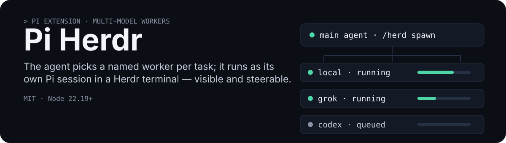
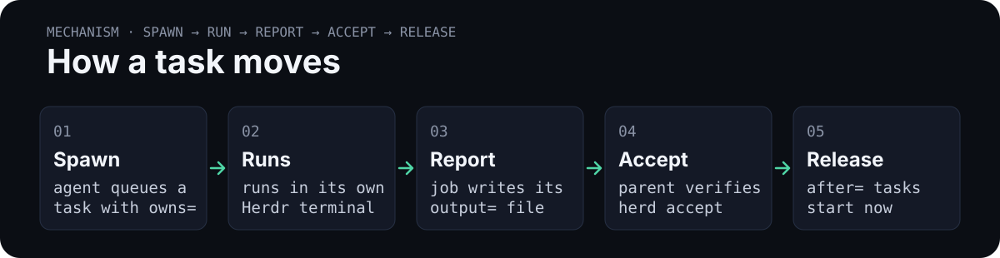

<p align="center">
  
</p>

# Pi Herdr

A Pi extension for delegating work to **named workers** you define in `~/.pi/agent/herd.json`. Each worker is a model plus a concurrency limit; the main agent picks one per task and it runs as its own Pi session in a Herdr terminal, visible and steerable while it works.

Worker names are yours — `local`, `grok`, and `codex` below are examples, not requirements. The name `local` is the only special one: it is the trusted worker that `private=true` routes to. Nothing else is a pipeline stage; there is no default assignment and no fixed “think”/“do” role.

What it does for you:

- **Fan out work.** Queue many tasks; each runs up to its worker's `maxConcurrent`. Ten small tasks can queue while two run at once.
- **Mix models per task.** Use a cheap or local model for small verifiable changes, and stronger cloud models for implementation, investigation, or an independent review — the agent chooses per task.
- **Keep work from colliding.** Tasks that would edit the same files run one at a time (`owns=` write lanes); dependent tasks (`after=`) start only after you accept their prerequisites.
- **Keep private data local.** `private=true` forces the task to the `local` worker with no cloud fallback, and auto-redaction keeps recognized secrets out of cloud-facing results and model requests.

## 1. Install

You need **Pi 1.5.0+, Herdr, Node.js 22.19+, and working model connections in Pi**. This extension uses those connections; it does not provide subscriptions or configure model servers.

Run Pi inside [Herdr](https://herdr.dev), then install:

```bash
pi install npm:@itc-steve/pi-herdr
```

For a local checkout, use `pi install /path/to/pi-herdr` instead. Run `/reload` afterward. Remove other Herdr extensions first; this package includes both the `herd` and `herdr` tools.

## 2. Choose your workers

Save this as `~/.pi/agent/herd.json`, or start from [herd.json.example](herd.json.example).

**Replace the four model placeholders with exact `provider/model` IDs available in your Pi setup.** The worker named `local` must point to your trusted local model.

```json
{
  "workers": {
    "local": {
      "model": "local-provider/local-model",
      "thinking": "medium",
      "maxConcurrent": 2,
      "description": "Bounded tasks and private data. Always use medium thinking; never override it."
    },
    "grok": {
      "model": "grok-provider/grok-model",
      "thinking": "medium",
      "maxConcurrent": 1,
      "description": "Research and independent critique. Use medium normally, high for difficult analysis."
    },
    "codex": {
      "model": "openai-codex/your-sol-model",
      "thinking": "medium",
      "maxConcurrent": 1,
      "group": "codex",
      "description": "Implementation and tests. Use medium normally, low for mechanical edits, high for difficult work."
    },
    "astra": {
      "model": "openai-codex/your-astra-model",
      "thinking": "medium",
      "maxConcurrent": 1,
      "group": "codex",
      "description": "Difficult diagnosis, architecture, and high-consequence decisions. Use medium/high; xhigh only for exceptional unresolved problems."
    }
  },
  "private": { "enabled": false }
}
```

Use a `thinking` level supported by each model. These defaults keep local thinking at medium and reserve Astra `xhigh` for exceptional tasks via a per-spawn override; descriptions guide the agent, not enforce allowed levels. Sol and Astra share `group: "codex"` and the same capacity, so adding Astra does not double OpenAI concurrency. Omit Astra if unavailable in your model catalog. `maxConcurrent` limits running jobs, not how many you can queue. Worker descriptions help the main agent choose. The `local` worker is required for private tasks; every other worker is optional — define only the workers you actually have connections for, with any names you like.

Configured worker names, models, thinking levels, concurrency limits, and descriptions are included in the tool's model-facing guidance before the first call and refreshed on each new agent run, including result-triggered runs. Describe each worker's best-fit tasks and limits so the parent has a useful basis for choosing; worker names do not imply capabilities. Keep descriptions free of private data—they enter the parent's model context.

Run `/herd models` to check current configuration and model-registry diagnostics. Spawns reject unknown model IDs and invalid thinking levels before allocating a job; valid but unsupported thinking levels are clamped using Pi's model capabilities and reported. Registry checks do not prove server availability or valid credentials. Config edits refresh guidance on the next run without `/reload`; already queued jobs keep their selected settings. To use private tasks and auto-redaction, set `private.enabled` to `true` after configuring your local model.

## 3. Ask normally

You do not need to manage workers by hand. For example:

> Fix this bug. Delegate small, well-defined changes to local workers. Use Grok or Codex for anything complex, and get an independent review if useful.

Or:

> Process these customer records locally. Return counts by error category—no names, identifiers, or raw records.

The agent creates a run, queues tasks, reads their reports, and checks the results. Workers appear in background Herdr tabs. The main agent keeps control; workers cannot spawn more workers.

### Ovis chat

Workers advertise their per-run session store with `PI_CODING_AGENT_SESSION_DIR`, matching the explicit `--session` file. This lets Ovis authorize herd sessions without moving them or switching Pi into RPC mode. Ovis still needs Herdr's Pi session-reporting integration and access to the foreground Pi process environment; the custom-store contract is verified on Linux. Existing Ovis authentication and path checks remain intact. Private workers' transcripts are also available to the already-authorized Ovis UI—they are not hidden from the local user.

After updating this extension, finish or abort active jobs, then `/reload` before spawning new workers. Existing worker processes retain their old launch environment.

## How coordination works

- **`worker=` chooses who.** Local, Grok, and Codex are choices, not stages in a pipeline.
- **`owns=` lists files a task may edit.** Use comma-separated project-relative files or directories, not globs. Without it, the task is report-only.
- **Conflicting work waits.** Overlapping writers run one at a time. Report-only tasks wait for writers in the same project and hold off later writers while reviewing.
- **`after=` sets order.** It lists already-submitted job IDs. A dependent task starts only after the main agent accepts those results.
- **`output=` names the report.** Each job needs its own report path under the run directory. Completion messages point to these files.

**Completed does not mean approved.** The main agent reads the report, checks the work, then uses `accept`. Workers should report what changed, checks run, anything unverified, and blockers.

<p align="center">
  
</p>

For larger assignments, include: **objective, inputs, owned files, acceptance criteria, verification command, and when to stop**. Plain-text tasks work too; no special template is required.

### Worker-to-worker messages

Ask normally: **“Build the frontend and API in separate lanes; coordinate the request format directly.”** Workers discover each other and exchange short notes without the parent copying messages between panes. Herd still controls scope, scheduling, file ownership, and acceptance.

You can inspect or send notes yourself:

```text
/herd peers
/herd message jobId=JOB_ID text="Does PATCH /settings accept partial updates?"
/herd messages
```

`peers` lists worker IDs, labels, and states. `messages` shows the last 20 notes with **queued**, **delivered**, or **recipient-finished** status; add `run=RUN_ID` to inspect another run owned by this parent session. Workers see only their own incoming/outgoing notes and peers in their run. Use exact job IDs from `peers`.

Notes appear in the recipient's Pi conversation after a model/tool turn—not while a shell command is running. **Delivered means entered Pi context, not understood or answered.** Answers must be sent through `herd message`; chat alone is not forwarded. A parent note needs no tool reply: workers report back through their normal artifact.

Safety and limits:

- No automatic replies or broadcasts. Workers have 20 outgoing notes each, limited to 4096 UTF-8 bytes per note. They must continue independent work or report blockers, not wait indefinitely for replies.
- Booting/queued workers cannot receive notes. Finished workers never restart; late notes remain in the log for the parent to resolve. Completion notices flag notes left undelivered at settlement.
- Private workers are excluded. Recognized secrets and private markers are rejected before storage, but this does **not** detect all PII. Keep private data in the private-local workflow.
- Read-only review jobs still wait for writers under the existing scheduling rules. Messaging does not bypass that separation.
- No extra server or dependency. Atomic, owner-private files live under `<run>/.mailboxes/<parent-namespace>/`. Reload/shutdown closes admission; files remain for inspection, not automatic resume. There is no exactly-once guarantee across crashes or protection against same-user filesystem tampering.

### Example: local fix, then Codex review

These are Pi slash commands, not shell commands. Replace the example source paths with files in your project.

```text
/herd run create name=login-fix goal="Fix the login redirect"
/herd spawn worker=local task="Apply the agreed redirect fix and add a regression test. Run the relevant tests and report results." owns=src/client.ts,test/client.test.ts output=fix.md
```

Copy the returned job ID. Replace `FIX_JOB_ID` below with that ID:

```text
/herd spawn worker=codex after=FIX_JOB_ID task="Review the finished diff and test evidence. Report bugs and missing checks; do not edit files." output=review.md
```

The review waits. Once the fix finishes, have the main agent read `fix.md` and verify it, then:

```text
/herd accept jobId=FIX_JOB_ID
```

Codex can now review. The same pattern works with Grok, or with a cloud worker implementing and another worker reviewing. Reviews are optional—not a required step for every small task.

### Example: private local task

With private mode enabled:

```text
/herd spawn private=true task="Inspect the specified customer records locally. Return counts by error category only. Do not include names, identifiers, or record excerpts." output=private-summary.md
```

`private=true` selects local automatically and never falls back to cloud. Add `owns=` if the task needs to edit project files. Give the local worker enough information to locate the inputs without putting sensitive values in the cloud-facing task text.

## Privacy: nudges plus redaction

The main agent is prompted to delegate **customer information, personally identifiable information (PII), confidential records, credentials, and secrets** before retrieving them. Local workers are asked to return sanitized findings, safe aggregates, or status only. Cloud reviews should receive only sanitized material.

Auto-redaction masks recognized secrets in cloud-facing tool results and model requests. A `[PRIVATE:…]` marker tells the agent to delegate locally rather than try another retrieval method.

Private workers start with `--no-mcp`, disabling Pi's built-in MCP connections. This does not disable network access through bash, other extensions, or a replacement MCP implementation.

**This is not guaranteed containment.** Regex detection can miss ordinary PII, unfamiliar formats, and images. The configured local endpoint must actually be trusted. If local/private mode is unavailable, the prompt tells the agent to stop and ask rather than send sensitive inputs to cloud.

## Useful commands

| Command | Purpose |
| --- | --- |
| `/herd models` | Show configured workers |
| `/herd status` | Show queued, running, completed, accepted, failed, aborted, or blocked jobs |
| `/herd accept jobId=JOB_ID` | Approve a completed result and release dependent tasks |
| `/herd wait jobId=JOB_ID` | Wait for a job to finish or become blocked |
| `/herd collect jobId=JOB_ID` | Read a completed job's reply |
| `/herd steer jobId=JOB_ID task="…"` | Nudge a running worker within its existing scope |
| `/herd peers [run=RUN_ID]` | List this run's mailbox workers |
| `/herd message jobId=JOB_ID text="…"` | Send an advisory note to a worker |
| `/herd messages [run=RUN_ID]` | Inspect recent notes and delivery status |
| `/herd abort jobId=JOB_ID` | Request cancellation; use `all=true` to cancel all active jobs |
| `/herd close jobId=JOB_ID` | Stop the job and close its pane |
| `/herd help` | Show command syntax |

Use **`herd` to assign work** and **`herdr` to view or control terminals**. Do not send new assignments directly into worker panes with `herdr run`.

## Settings and limits

Most settings can stay at their defaults:

| Setting | Default / purpose |
| --- | --- |
| `sessionDir` | `~/.pi/agent/herd`; stores run notes, reports, sessions, and journals |
| `workers.<name>.group` | Defaults to the worker name; use the same group for workers sharing a subscription |
| `workers.local.preflight` | `true`; check local availability before booting a worker |
| `defaults.timeoutMs` | `600000`; stall timeout; only active work extends it, not a blocked user prompt |
| `defaults.resultDelivery` | `"pointer"`; use `"full"` to include replies in completion messages |
| `defaults.triggerTurnOnResult` | `true`; let completion messages wake the main agent |

For an individual spawn, `model=` selects an exact model instead of a worker name; `thinking=` overrides its reasoning level. `waitForReply=true` waits instead of returning immediately. A wait timeout does not cancel the job—use `abort` explicitly.

Keep these limits in mind:

- **Ownership adds an edit/write guard, not a filesystem sandbox.** Built-in `edit` and `write` are limited to `owns=` and the exact assigned report, with `forbid=` taking precedence and canonical path checks. Report-only workers can still write their report. Bash, arbitrary extension tools, hard links, and filesystem races are not isolated. Parent/manual edits must respect workers' files too; integration checks remain necessary.
- **Blocked prompts need attention.** Herd reports the job and pane in a warning/status indicator. It never answers trust or confirmation prompts automatically. If the stall/boot deadline expires, it attempts to stop or close the worker; reservations remain held if cleanup fails. A cancelled parent does not auto-restart when later results arrive; pointers still display.
- **Queues belong to one parent session.** Finish or abort work before `/reload`. There is no automatic queue resume or coordination between separate parent sessions; saved reports remain on disk.
- **Concurrency is not quota tracking.** Your parent session and other applications also consume subscription usage.
- **Failed dependencies block later tasks.** Resolve the issue, cancel the blocked dependents, and submit replacement work.
- If stopping a pane fails, its reservations remain held. Stop it and use `close` before continuing. `status` shows held reservations.

### Upgrading from think/do

> **Warning — 2.0 is a breaking overhaul.** Spawn is no longer default-local. Rewrite `~/.pi/agent/herd.json` to the `workers` map, then `/reload`. Bare `role=think|do` does not assign work. Writers need `owns=`. `after=` waits for `herd accept`, not completion. Old `local` / `do[]` / `think[]` files still load, but migrate.

**Required for 2.0.** Old `local`, `do[]`, `think[]`, and `maxModelConcurrent` still load as named workers so Pi starts, but spawn and prompts already follow 2.0.

1. Copy [herd.json.example](herd.json.example) over `~/.pi/agent/herd.json` and put your real `provider/model` IDs in `workers.local`, `workers.grok`, and `workers.codex`.
2. Move `maxModelConcurrent` onto `workers.local.maxConcurrent` (and per-cloud `maxConcurrent`, usually `1`).
3. Keep `private.enabled` as you had it.
4. `/reload`, then `/herd models`.
5. Replace bare spawns and `role=think|do` with `worker=local|grok|codex` (or `model=`).
6. Add `owns=` on every writer. After a job finishes, read its artifact and `/herd accept jobId=…` before dependents run.
7. Finish or abort in-flight jobs before `/reload`. Queues do not resume.

## Development

```bash
npm ci --ignore-scripts
npm test
npm run typecheck
```

Tests use fake Herdr clients, without invoking models. `README.md` is the user documentation; packaged `SKILL.md` files are runtime instructions for agents. MIT license—see [LICENSE](LICENSE).
